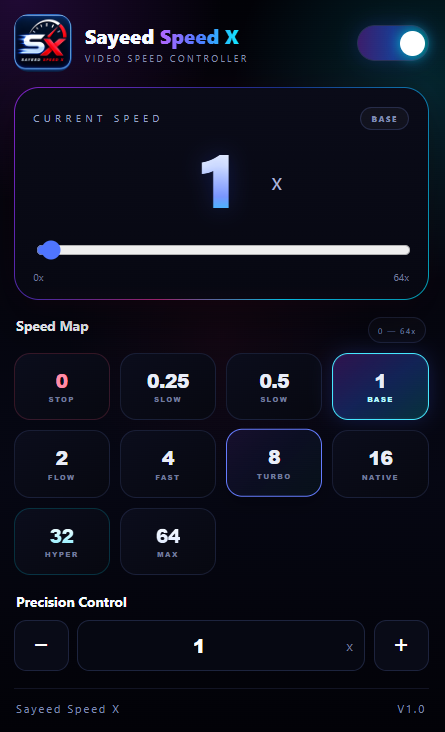

# Sayeed Speed X

### Take control of your video playback.

Sayeed Speed X is a lightweight Chrome extension that gives you greater control over video playback speed. Whether you're watching tutorials, online lectures, or other video content, adjust the speed to match your preferences.

## Preview

<p align="center">
  
</p>

## Features

- **Flexible Speed Control** — Adjust playback speed from 0x to 64x.
- **Quick Presets** — Switch between predefined playback speeds.
- **Precision Adjustment** — Fine-tune playback speed using the slider and custom controls.
- **Simple Controls** — Enable or disable the controller whenever needed.
- **Saved Preferences** — Retain selected settings using Chrome local storage.
- **Native Video Support** — Designed to control HTML5 video playback.

## Tech Stack

- JavaScript (ES6+)
- HTML5
- CSS3
- Chrome Extensions API
- Chrome Extension Manifest V3

## Installation

1. Clone or download this repository.
2. Open Google Chrome and navigate to `chrome://extensions`.
3. Enable **Developer mode**.
4. Click **Load unpacked**.
5. Select the project folder containing `manifest.json`.

## Project Structure

```text id="k5ax3n"
Sayeed-Speed-X-v1.0/
├── icons/
├── background.js
├── content.js
├── manifest.json
├── popup.css
├── popup.html
├── popup.js
├── README.md
└── screenshot.png
```

## Compatibility

Designed for Google Chrome and webpages that use HTML5 video. Playback behavior may vary by website, particularly at very high speeds.

## Author

**Sayeed Anwar**

Developed to make video playback more flexible and convenient.

---

If you find this project useful, consider giving the repository a star on GitHub.